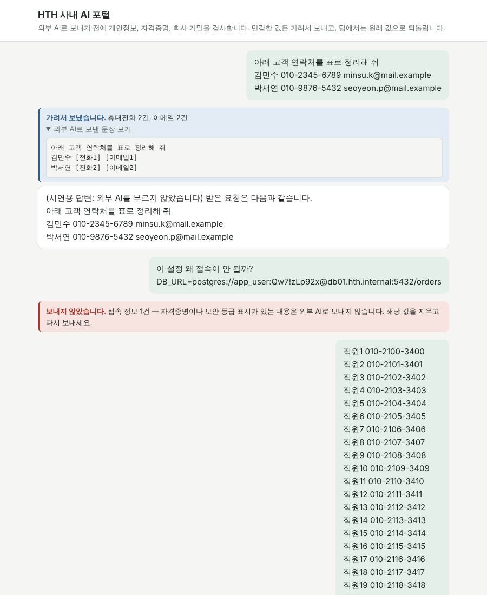

# Deskguard

회사 직원이 ChatGPT 같은 외부 생성형 AI에 보내는 프롬프트를 **나가기 전에** 검사하는 정보 유출 방지 게이트웨이와 사내 AI 포털이다. 개인정보, 자격증명, 회사 기밀을 코드로 탐지해서 허용, 가림, 경고, 차단 중 하나로 처리한다. 학습용 포트폴리오 프로젝트이며 실제 서비스가 아니다.



## 무엇을 하나

| 처리 | 조건 | 동작 |
|---|---|---|
| 허용 | 탐지된 값이 없다 | 그대로 외부 AI로 보낸다 |
| 가림 | 개인정보(D1)나 회사 코드명, 고객사(D3)가 있다 | 값을 `[전화1]` 같은 가명으로 바꿔 보내고, 답이 돌아오면 원래 값으로 되돌려 보여 준다 |
| 경고 | 개인정보가 많다(20개 이상) | 직원에게 확인을 받은 뒤 가려서 보낸다 |
| 차단 | 자격증명(D2)이나 보안 등급 표시가 있다 | 보내지 않고 이유를 알린다 |

- 탐지는 정규식, 검증 숫자, 회사 사전으로 하며 **운영 경로에서 외부 판정 서비스를 부르지 않는다.** 검사를 위해 민감한 문장을 다른 곳으로 보내지 않는다.
- 로그에는 원문, 탐지한 값, 가명 대응표를 남기지 않는다(처리, 항목별 개수, 길이, 해시, 지연만 남긴다).
- 왜 만드는지는 [문제 정의서](./docs/problem.md), 탐지 항목과 정책은 [정책서](./docs/policy.md)에 있다.

## 측정 결과

평가 세트는 생성형 AI 3종이 만든 업무 요청 틀에 코드가 만든 **가짜 값**을 채운 합성 문장이다(596문장). 측정 전에 평가 세트, 탐지 설정, 대량 기준을 해시로 동결했고 결과를 보고 규칙을 바꾸지 않았다. 윌슨 95% 구간은 괄호에 적었다. 상세는 [X·Y·T 보고서](./docs/eval/results/report_xyt_v1.md)와 [우회 시험 보고서](./docs/eval/results/report_bypass_v1.md)에 있다.

| 지표 | 결과 |
|---|---|
| X: 개인정보(D1) 탐지율 | 98.1% (97.0~98.8%) |
| X: 자격증명(D2) 탐지율 | 81.7% (75.4~86.6%) |
| X: 회사 기밀(D3) 탐지율 | 100% (96.8~100%) |
| Y: 정상 문장 오탐율 | 0 / 106 (0~3.5%) |
| T: 검사, 가림, 복원 지연 | 서버 중앙값 0ms, 95백분위 1ms 이하 |
| 우회 시험(변형 96문장) | 25개만 탐지(26%), 변형하지 않은 대조는 24/24 |
| Z: 가림 후 답의 쓸모 | 측정 예정 |

**한계를 먼저 적는다.**

- 놓친 정답은 **비밀번호**(값만 있는 형태 33건)와 **계좌 번호**(은행이나 "계좌" 같은 문맥어가 없는 형태 16건) 두 항목뿐이다. 규칙 기반 탐지는 값 모양만으로 이 둘을 구분하지 못한다.
- 합성 문장이라 실제 직원 문장보다 탐지율이 높게 나왔을 수 있다. D3의 100%는 사전과 같은 값을 넣었기 때문이다(사전에 없는 이름은 탐지하지 못한다).
- 우회에 약하다. 전각 숫자, 한글 숫자(`공일공…`), 이메일 `at` 표기, 키 쪼개기, 글자 띄어쓰기, 보이지 않는 문자를 넣으면 대부분 통과한다. 접속 문자열 변형은 일부만 가려져 나머지가 나가는 경우도 있었다. 입력 정규화는 후속 개선 후보이다.
- 서버 지연은 밀리초 단위로 재서 1ms 미만은 구분하지 못한다. 외부 AI 호출 시간은 포함하지 않는다.

## 실행하기

필요한 것: JDK 25, Maven 3.9, Python 3. API 키 없이 시연과 시험이 된다.

```bash
# 키 없이 포털 시연 (http://localhost:8080). 외부 AI 대신 받은 문장을 되돌려 주는 시연용 응답 모델을 쓴다
cd backend
mvn spring-boot:run "-Dspring-boot.run.arguments=--gateway.demo-answer=true"

# 자동 시험 (키 없이 통과한다)
cd backend && mvn -B test
cd backend/scripts && python -m unittest test_fake_values test_measure test_build_eval_set test_build_bypass_set test_z_measure

# 측정 (측정 모드는 같은 컴퓨터의 요청에만 응답하고 외부 AI를 부르지 않는다)
cd backend
mvn spring-boot:run "-Dspring-boot.run.arguments=--gateway.measurement-mode=true"
cd backend/scripts && python measure.py --input ../../docs/eval/set/eval_v1.jsonl --out result.json
```

실제 외부 AI(Gemini)를 쓰려면 환경변수 `GEMINI_API_KEY`를 설정하고 `--gateway.demo-answer=true` 없이 실행한다. 키는 파일이나 대화에 쓰지 않는다. Z 측정(가림 후 답의 쓸모)은 Gemini와 Jev 키가 필요하며 절차는 [handoff.md](./docs/handoff.md) 3절에 있다.

## 개발 방식

SDD와 TDD를 병행한다. 기획은 문제 정의, 정책, 명세([`spec.md`](./docs/spec.md)), 설계([`design.md`](./docs/design.md)), 작업 목록([`tasks.md`](./docs/tasks.md)) 순서로 확정한다. 구현은 수용 기준(AC)에서 실패하는 시험을 먼저 쓰고 최소 코드로 통과시킨다. 구현 중에 명세의 빈칸이 드러나면 코드보다 명세를 먼저 고친다. 탐지율처럼 확률적인 품질은 시험이 아니라 위의 측정으로 검증한다. 결정의 근거는 [`DECISIONS.md`](./DECISIONS.md), 남은 위험은 [`open-risks.md`](./docs/open-risks.md)에 있다. 이어서 작업하려면 [`handoff.md`](./docs/handoff.md)를 먼저 읽는다.

주제를 한 번 바꿨다(2026-10-29, 사내 HR 헬프데스크 챗봇의 입력 가드레일에서 정보 유출 방지 게이트웨이로). 이전 문서는 `docs/archive/`에 있고 경위는 [작업 일지](./docs/worklog.md)에 있다.

## 데이터 출처와 라이선스

| 자료 | 어디에 있나 | 출처와 조건 |
|---|---|---|
| deepset/prompt-injections | `dataset.csv`의 일부 행 | deepset, Apache-2.0 |
| JailbreakBench JBB-Behaviors | `dataset.csv`의 일부 행 | JailbreakBench Team, MIT (인용 요청 있음) |
| KOICA 인사규정 질의응답 세트 | `docs/eval/koica_hr_questions_raw.csv` | 한국국제협력단, 공공데이터포털, 이용허락범위 제한 없음(출처 표시) |
| 업무 요청 틀, 평가 세트의 값 | `docs/eval/` | 생성형 AI가 만든 문장과 무작위 가짜 값 |

전체 출처, 라이선스 전문, 인용은 [THIRD_PARTY_NOTICES.md](./THIRD_PARTY_NOTICES.md)에 있다. 이 저장소의 자체 코드와 문서의 라이선스는 아직 정하지 않았다.
